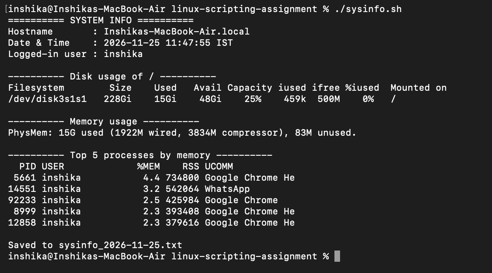
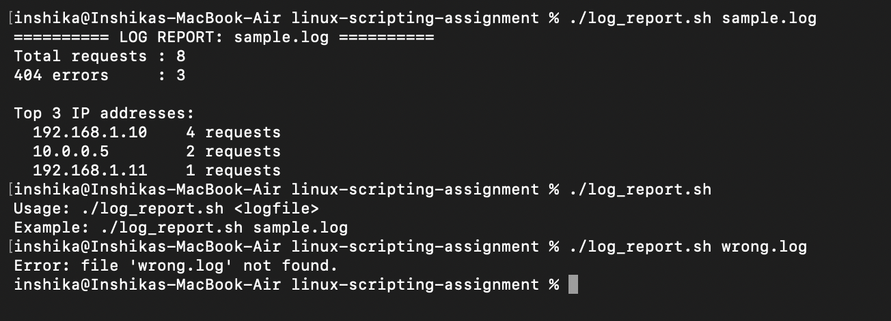
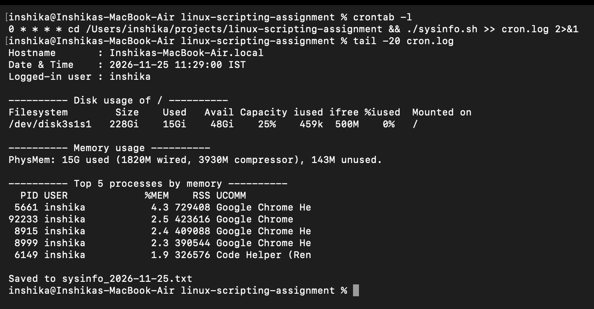

# Linux Shell Scripting & Git Assignment

This repo has my solution for Assignment 1 of the DevSecCops DevOps campus drive.
I wrote two small Bash scripts: one shows system information and one reads a web server log and gives a short report.

I did this on my MacBook, but I also made the script work on Linux, because most servers run Linux.

## Files

- `sysinfo.sh` - shows hostname, date and time, logged-in user, disk usage of `/`, memory usage and the top 5 processes by memory. It also saves the output in a file with today's date.
- `log_report.sh` - takes a log file and prints the total number of requests, how many were 404 errors, and the top 3 IP addresses.
- `sample.log` - a small sample access log that I made for testing.
- `screenshots/` - screenshots of the scripts running on my Mac.

## How to run

```bash
git clone https://github.com/inshikagupta/linux-scripting-assignment.git
cd linux-scripting-assignment
chmod +x sysinfo.sh log_report.sh

./sysinfo.sh
./log_report.sh sample.log
```

## Output

### sysinfo.sh

```
========== SYSTEM INFO ==========
Hostname       : Inshikas-MacBook-Air.local
Date & Time    : 2026-11-25 10:51:44 IST
Logged-in user : inshika

---------- Disk usage of / ----------
Filesystem      Size    Used   Avail Capacity iused ifree %iused  Mounted on
/dev/disk3s1s1  228Gi    15Gi    48Gi    25%    459k  503M    0%   /

---------- Memory usage ----------
PhysMem: 15G used (1896M wired, 3767M compressor), 201M unused.

---------- Top 5 processes by memory ----------
  PID USER             %MEM    RSS UCOMM
 5661 inshika           4.3 725104 Google Chrome He
92233 inshika           2.8 477424 Google Chrome
 8915 inshika           2.5 418592 Google Chrome He
85607 inshika           2.4 399984 WhatsApp
 8999 inshika           2.2 376960 Google Chrome He

Saved to sysinfo_2026-11-25.txt
```



### log_report.sh

With the sample log:

```
========== LOG REPORT: sample.log ==========
Total requests : 8
404 errors     : 3

Top 3 IP addresses:
  192.168.1.10    4 requests
  10.0.0.5        2 requests
  192.168.1.11    1 requests
```

If I run it without a file, it shows how to use it:

```
Usage: ./log_report.sh <logfile>
Example: ./log_report.sh sample.log
```

If the file doesn't exist, it shows an error instead of crashing:

```
Error: file 'wrong.log' not found.
```



## Bonus

I did all three bonus parts:

1. `log_report.sh` prints a usage message when no file is given.
2. `sysinfo.sh` saves its output to a file like `sysinfo_2026-11-25.txt`.
3. I added a cron job that runs `sysinfo.sh` every hour:

```
0 * * * * cd /Users/inshika/projects/linux-scripting-assignment && ./sysinfo.sh >> cron.log 2>&1
```

`0 * * * *` means "at minute 0 of every hour". I added `cd` first because cron starts in the home folder, and `>> cron.log 2>&1` saves both the output and any errors to a log file so I can check if it ran.

To test it, I first set it to run every minute (`* * * * *`). After I saw it running in `cron.log`, I changed it to every hour.



## Problems I faced

- **`free` and `ps --sort` don't work on macOS.** These are Linux commands. On my Mac I got errors, so I used `uname -s` to check the OS. On macOS the script uses `top -l 1` for memory and `ps -m` to sort by memory, and on Linux it uses `free -h` and `ps --sort=-%mem`.
- **Process names were too long.** On macOS, `comm` showed the full path of every app (very long for Chrome). I changed it to `ucomm`, which shows only the short name.
- **Output files in Git.** `sysinfo.sh` and cron create new output files every hour, so I added them to `.gitignore` to keep the repo clean.

## What I learned

- How the shebang line (`#!/usr/bin/env bash`) tells the system which shell runs the script
- Using `awk` to pick columns from a log file, and `sort | uniq -c | sort -rn` to count and rank things
- How `chmod +x` makes a script executable
- How to schedule jobs with cron and debug them with a log file
- That macOS and Linux have different versions of some commands, so scripts need to handle both
